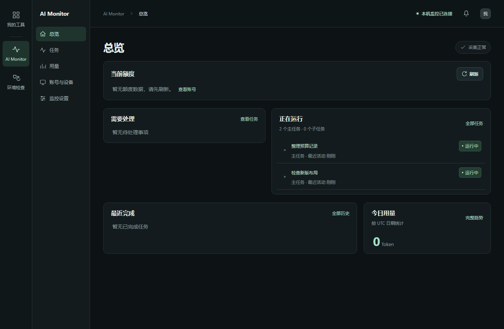

# AI Work Monitor · Windows 个人工具箱

在 Windows 上用 Codex 时，可以从「我的工具」打开 **AI Monitor** 查看正在运行的任务、账号剩余额度和项目 Token 用量。如果刚完成的会话没有出现，可以切到 **环境检查**，确认 Monitor 能否读到对应的会话日志。两项工具都随桌面客户端提供，单机使用无需注册平台账号。

**获取 Windows 版**　已发布的 `v0.2.0-candidate.5` 预发布安装包打开后直接进入监控台。要使用本文展示的「我的工具」和环境检查，请从包含此 README 的源码启动。[下载个人监控台](https://github.com/ZedekiahS/ai-work-monitor-personal/releases/tag/v0.2.0-candidate.5) · [从源码启动](#从源码启动)

## 工具怎么用

| 你想做什么 | 从哪里开始 |
| --- | --- |
| 看任务进度、找回一次会话 | 打开 **AI Monitor → 任务**。在「当前」查看主任务和子 Agent，在「历史」按关键词、来源或账号筛选，点开会话可查看「事件与回放」。 |
| 查还剩多少额度、哪个项目用得多 | 在 **AI Monitor → 总览** 查看账号额度和重置时间。在 **用量** 查看项目及模型的 Token 统计。 |
| 排查会话为什么没出现 | 在任务页点 **检查来源**。环境检查会带入选中的来源。运行检查即可看到目录和日志是否可读，以及最近收录的会话活动。点 **返回 Monitor 任务** 可继续使用原筛选。也可以从左栏直接进入环境检查，查看本机 Codex CLI 和 Hooks 状态。 |
| 调整提醒或复用一套偏好 | 进入 **AI Monitor → 监控设置 → 通知预设与偏好文件**。可导出当前的通知与刷新偏好，也可选择提醒预设或导入偏好文件，核对差异后应用。 |

左栏可以随时切换工具。在 AI Monitor 内，第二栏提供总览、任务、用量、账号与设备和监控设置。下图使用示例任务。



如果只想在桌面看剩余额度，可以从 Monitor 总览打开「用量浮窗」，也可以单独构建只查询当前账号余额的 **AI 额度窗**。查询额度需要本机 Codex 已登录。[Monitor 浮窗使用说明](docs/USAGE_WIDGET.md) · [独立额度窗](apps/quota-window/README.md)

## 从源码启动

准备 Windows x64 和 Node.js 24 或更高版本。在包含此 README 的仓库根目录打开 PowerShell，首次运行以下命令。

```powershell
npm ci
npm run build
npm run desktop:prepare
npm run desktop
```

`desktop:prepare` 下载本项目锁定版本的 Electron。之后可直接用 `npm run desktop` 打开「我的工具」。关闭主窗口后，Monitor 会继续在托盘采集。要完全退出，在托盘菜单选择「退出并停止本产品采集」。

也可以在构建后运行 `npm start`，用浏览器打开终端打印的完整本机链接。默认监听 `127.0.0.1:4318`，链接包含本机访问凭据，请仅在本机使用。

## 数据与共享

个人客户端默认在本机保存任务、用量和部分会话文本。本机数据库和备份可能含有私人对话。Hooks 默认关闭，需要更细的任务状态时可自行启用。环境检查中的「运行 Codex 诊断」由用户手动触发，包含网络连接检查。[隐私与共享范围](docs/PRIVACY_AND_SHARING.md) · [Hooks 设置](docs/HOOKS.md) · [历史与备份恢复](docs/HISTORY_RECOVERY.md)

账号剩余额度按账号和额度窗口分别展示，缺失或过期时显示未知。Token 总量按输入加输出计算，缓存输入和推理 Token 已分别包含在对应项中。任务缺少状态证据时也会显示未知。[用量统计口径](docs/USAGE_RECONCILIATION.md) · [能力与限制](docs/CAPABILITIES.md)

要跨电脑查看自己的用量，可自建本人同步服务，每台设备单独配对。加入公司空间时，由本人选择共享范围，发送的是授权元数据，对话正文、代码和登录凭据留在本机。此开源仓库提供个人客户端、本人同步服务和员工连接器，企业管理后台、跨员工统计与审计在独立的企业版仓库维护。[本人同步服务](packages/sync-service/README.md) · [连接第二台电脑](docs/SECOND_DEVICE.md)

## 开发与打包

完成上述构建后，可运行以下检查。

```powershell
npm run typecheck:ui
npm test
npm run test:ui
npm run test:local-http
```

开发本机服务使用 `npm run dev`。制作 Windows 安装包使用 `npm run package:win`，输出目录为 `release/`。打包时需提供与 Node 运行时版本一致的官方许可证，脚本会读取 `node.exe` 同目录的 `LICENSE`，也可通过 `AIWM_NODE_LICENSE` 指定路径。未配置代码签名证书时会生成未签名安装包。

<details>
<summary>开发本人同步服务</summary>

本人同步服务使用独立依赖、PostgreSQL 18、可信 HTTPS 和独立凭据。在仓库根目录运行以下命令构建并测试。

```powershell
npm run build:protocol
npm ci --prefix packages/sync-service
npm run build --prefix packages/sync-service
npm run test:personal-sync
```

</details>

有关个人版与企业版的源码拆分、浮窗验证和现场验收范围，见[源码拆分记录](docs/REPOSITORY_SPLIT.md)与[浮窗验证记录](docs/WIDGET_ACCEPTANCE.md)。

## 许可证

个人版项目代码采用 MIT 许可证，第三方组件适用各自的许可证。[MIT 许可证](LICENSE) · [第三方声明](THIRD_PARTY_NOTICES.md)
